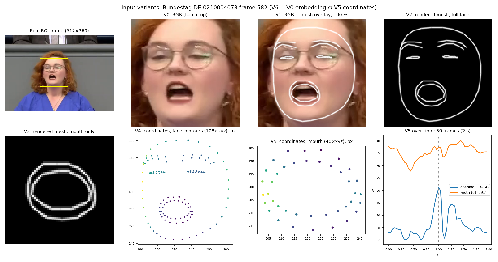
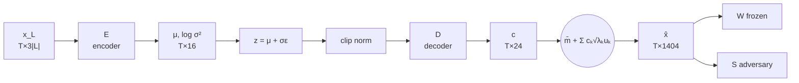

# Models and input variants

This file covers the model architecture and the input-variant experiments (Baustein 3 + 4 in the README).
The dataset (BTLips) is in [`DATASET.md`](DATASET.md).

## 1. Architecture decision

**Model = NASNet-Mobile encoder (per frame) → DC-TCN back-end (Ma et al.) → word classifier.**

```
video (T frames) ──► NASNet-Mobile, shared over frames ──► T × D embeddings ──► DC-TCN ──► mean over time ──► linear ──► word
```

| Part | What | Source |
|---|---|---|
| Encoder | NASNet-Mobile, 2D, applied to every frame with shared weights. Its globally pooled feature is the frame embedding. | Zoph et al. 2018. Used for German lipreading on GLips by Ameer et al. |
| Back-end | Densely Connected TCN (DC-TCN): dense temporal-conv blocks with several dilations and kernel sizes, plus squeeze-and-excitation. | Ma, Wang, Petridis, Shen, Pantic: *Lip-reading with Densely Connected Temporal Convolutional Networks*, WACV 2021 (LRW). |
| Head | Temporal mean pooling + linear layer over the word vocabulary. | as in Ma et al. |

Ma et al. pair DC-TCN with a 3D-conv + ResNet-18 front-end. We keep their back-end and **swap the front-end for NASNet-Mobile**.

### Why
- **NASNet works on German.** Ameer et al. reach 0.484 accuracy / 0.485 F1 on their 15-word GLips task with NASNet-Mobile.
- **The Martinez front-end underperformed against NASNet in our BWKI runs.** On Ameer's exact data regime (full face, 128×128, 16 frames, min-max norm, flip-only aug), our 3D-conv + ResNet-18 + MS-TCN model (Martinez et al. 2020) peaked at **0.225 val top-1** (`lipreading/mstcn_baseline/checkpoints_15_ameer/metrics.csv`), compared with NASNet's 0.484.
- **DC-TCN instead of MS-TCN.** DC-TCN is the stronger temporal back-end on LRW in Ma et al.

## 2. Input variants

The **DC-TCN back-end, head, clip length, splits (speaker-disjoint) and training recipe stay identical** across variants. Only the input, and therefore the encoder, changes.

| ID | Input | Encoder | What it tests | Privacy (expected identity leakage) |
|---|---|---|---|---|
| **V0_face** | RGB video, face crop (same crop as V1/V2) | NASNet | Baseline for V1/V2 | high |
| **V0_mouth** | RGB video, mouth crop (same crop as V3, as in BWKI) | NASNet | Baseline for V3/V6 | high |
| **V1** | RGB with the FaceMesh drawn on top at 100 % opacity | NASNet | Does an explicit mesh help the pixel model? | **highest** (face + mesh geometry) |
| **V2** | Rendered mesh, **full face**, black background, no video | NASNet | Mesh as an image, without skin/texture | medium |
| **V3** | Rendered mesh, **mouth only**, black background | NASNet | Mesh, restricted to the lips | low–medium |
| **V4** | Coordinates, **face contours** (128 points × xyz, the points V2 draws) | Coordinate MLP (replaces NASNet) | Do landmarks suffice? | medium |
| **V5** | Coordinates, **mouth only** (40 lip points × xyz, the points V3 draws) | Coordinate MLP (replaces NASNet) | Do lip landmarks alone suffice? | lowest |
| **V6** | V0_mouth embedding **⊕** V5 coordinates, concatenated per frame | NASNet + coordinate MLP | Do coordinates add anything on top of pixels? | high |

V0 runs at both crops because the crop alone changes accuracy a lot (in BWKI the mouth crop lifted the model from near chance). Each image variant is compared with the RGB baseline at its own crop.

Hypotheses (not results): V1 is the worst for privacy. It may or may not beat V0_face. V6 ≥ V0_mouth. V5 < V4 < V0.

### Variant details
- **Landmarks:** MediaPipe FaceMesh (as in BWKI), run with `refine_landmarks=True`; the 10 iris points are dropped, so indices match BWKI's 468. "Full face" = 128 points of `FACEMESH_CONTOURS`, "mouth" = 40 points of `FACEMESH_LIPS`.
- **Matched pairs:** V2 ↔ V4 and V3 ↔ V5 use the same points and differ only in representation (image + NASNet vs. numbers + MLP). The other 340 points (cheeks, forehead) barely move in speech but encode face shape, so they are left out.
- **Coordinate normalization (V4–V6):** raw pixels → Procrustes-aligned (default) → speaker mean removed; the other two levels are the Baustein 4 ablation. *Speaker statistics* (here and in section 3): one value per speaker, computed only from that speaker's clips and applied to all of them. It is the mean of the speaker's per-word means, so a speaker's frequent words don't shift it (BTLips speakers say very different word mixes, 1–969 clips each). Per-word statistics within a speaker are never used: they would erase the differences between words. The transform is fitted on all 468 points (fitting on the lips alone would scale away mouth opening); the reference is the GPA mean shape of the training speakers (`FaceNorm`, fitted once).
- **Coordinate encoder (V4, V5):** per-frame MLP (BN → 512 → 1056, BN + ReLU), matching NASNet's T × 1056 output.
- **Crops:** square, centre tracked per frame (5-frame moving average), **one size per clip** (largest bbox side × margin: face +15 %, mouth +60 %) so mouth opening isn't scaled away. Encoder input 128 × 128, scaled to [-1, 1].
- **Rendering (V2, V3):** contour/lip edges (124 / 40), white, 2 px, on a 256 × 256 black canvas of the V0 crop, resized to 128 × 128. V1 draws the same onto the RGB crop.
- **Fusion (V6):** NASNet (1056) ⊕ 256-d lip-coordinate MLP; DC-TCN's first 1×1 layer projects the 1312-d input to 512.
- **Evaluation:** top-1, top-5, macro-F1 on the speaker-disjoint test split. Clips of one speaker are correlated, so 95 % intervals come from a bootstrap over the 170 test speakers, not over clips (`stats.py`). Every variant is trained once (seed 0); there is no budget for repeated seeds, so the speaker bootstrap is the only uncertainty estimate. Identity leakage: section 3, *Identity protocol*.

### Sample figure


`docs/figures/input_variants.png` shows one Bundestag frame (DE-0210004073, frame 582) in every representation. Made from a full pilot speech that has since been deleted.

## 3. Privacy (Baustein 4 + 5)

The anonymizer works on landmarks, not pixels. It takes the aligned FaceMesh points of a clip (T × 468 × 3) and returns `x̂`: the same mouth motion, with every speaker on one shared mean face. Only the lower face moves in `x̂`. The upper face (eyes, brows, forehead) stays at the mean face. Every landmark-only variant is then built from `x̂` instead of the real points. **V4/V5** read the 128 contour or 40 lip points of `x̂` directly. **V2/V3** render the same points onto the black canvas. V0, V1 and V6 contain video pixels, so this anonymizer can't cover them.

### Speaker model
`LipreadingModel(variant, num_classes = number of speakers)`: the exact word model from section 1, with speaker IDs instead of words. It is trained and tested on **different sitting days** of the same speakers (*Identity protocol* below); otherwise it learns session cues (clothing, lighting, camera, lectern) instead of identity. It measures identity leakage per input variant (Baustein 4) and is the adversary `S` below.

### Anonymizer: variational autoencoder with a fixed PCA output layer

Input: the Procrustes-aligned landmarks of one clip (`FaceNorm`), `x` (T × 468 × 3), of which E reads only the lower-face points L. Output: `x̂` (T × 468 × 3), with every speaker on the same mean face. V2–V5 are then built from `x̂` as usual.



#### Step 0: fixed quantities (computed once from the training speakers, not trained)
- **Mean face m̄** (1404 = 468 × 3): generalized-Procrustes mean shape over all training frames. All clips are aligned to it (`FaceNorm.ref`).
- **Lower face L** (`LOWER_IDX`, to add to `data/landmarks.py`): every mesh point that lies below the nose base (landmark 2) in m̄. This covers the lips, chin, jaw line and lower cheeks. |L| is fixed once m̄ is fitted. The upper face is left out on purpose. Blinks, brow raises and forehead motion aren't speech, and how often a speaker does them is an identity cue. In a full-face PCA they would take modes, and D could pass them through to `x̂`.
- **Motion PCA.** For every training frame, take the aligned landmarks of speaker *s* at time *t* on L, minus that speaker's mean shape on L: `d = x_{s,t,L} − x̄_{s,L}` (3|L| numbers): how far each point is from the speaker's resting face. PCA over all `d` (≈ 200 k sampled frames, 3|L| × 3|L| covariance) gives:
  - **modes uₖ** (3|L| each, embedded in 1404 with zeros outside L): patterns in which the lower-face points move together. Expected examples: k = 1 jaw opening, k = 2 lips spread vs. rounded, k = 3 upper lip raised.
  - **variances λₖ**: how much of the motion each mode explains.
  - K = 24 modes (to be confirmed: smallest K that explains ≥ 99 % of the variance; likely fewer than for the full face, since no modes go to blinks or brows).
- **Coefficient cₖ** = how much of mode k is in a frame, in units of its standard deviation √λₖ. `c₁ = +2` means "jaw open two standard deviations wider than usual".

#### Encoder E (1.45 M + 1.5 k · |L| parameters)
Input per frame: `x_{t,L} − m̄_L`, flattened to 3|L|, standardized per coordinate with training statistics. E never sees the upper face, so it can't carry upper-face identity cues into `z`.

| Layer | Output (per clip) |
|---|---|
| Linear(3\|L\|, 512) → BN → ReLU, per frame | T × 512 |
| Linear(512, 256) → BN → ReLU, per frame | T × 256 |
| 2 × residual temporal block: [Conv1d(256, 256, k = 5) → BN → ReLU] × 2, + skip | T × 256 |
| two 1×1 conv heads: Conv1d(256, 16) → **μ**, Conv1d(256, 16) → **log σ²** | T × 16 each |

The receptive field is 17 frames (0.7 s), enough for one word and its coarticulation. Only E sees the speaker's real landmarks.

#### Bottleneck
- **Sampling:** `z = μ + σ ⊙ ε`, ε ~ N(0, I), per frame and dimension (reparameterization, so the gradient flows through μ and σ). The noise stays on **at test time** too. It is the actual protection: an `x̂` built from μ alone could carry speaker details in tiny differences. For evaluation, `x̂` is also decoded from μ without noise, the worst case for privacy, and both are reported.
- **Clip norm:** each of the 16 dimensions is normalized over the T frames of the clip, `z̃_j = (z_j − mean_t z_j) / (std_t z_j + 10⁻⁵)`. This removes constant offsets (always slightly open) and amplitude (always wide) per clip.

#### Decoder D (0.7 M parameters)

| Layer | Output |
|---|---|
| Conv1d(16, 256, k = 5) → BN → ReLU | T × 256 |
| 1 × residual temporal block (as in E) | T × 256 |
| Conv1d(256, K = 24, k = 1), linear | T × 24 = **c** |
| fixed: `x̂_t = m̄ + Σₖ c_{t,k} √λₖ uₖ` (no trainable weights) | T × 1404 → T × 468 × 3 |

D can only choose *how much* of each real motion mode to add to the *same* mean face. It can't output a face shape, because there is no direction for one. Every output is a plausible face. Because the modes are zero outside L, the upper face of `x̂` is exactly m̄ in every frame.

#### Loss
$$
\mathcal{L} =
\underbrace{\mathrm{CE}\big(W(\hat{x}),\, y\big)}_{\text{content}}
+ \beta \, \underbrace{\mathrm{KL}\big(q(z \mid x) \,\|\, \mathcal{N}(0, I)\big)}_{\text{bottleneck}}
+ \lambda \, \underbrace{\mathrm{KL}\big(S(\hat{x}) \,\|\, \mathcal{U}_N\big)}_{\text{identity}}
$$

Symbols:
- $x$ is the input landmarks, $\hat{x}$ the anonymized landmarks, and $y$ the true word.
- $W(\hat{x})$ is the frozen word model's probability for each word. $W$ is the V4 model trained on real aligned landmarks. It reads the 128 contour points of $\hat{x}$ directly; $\hat{x}$ is already in the aligned frame, so the path is differentiable. The contour points include the eyes, brows and upper face oval, which are static in $\hat{x}$. $W$ was trained with them moving, so this is a small domain shift. If it costs accuracy, $W$ is fine-tuned on frames with the upper face set to m̄.
- $S(\hat{x})$ is the speaker adversary's probability for each of the $N$ training speakers.
- $\beta, \lambda \ge 0$ weight the terms. They are chosen on held-out **validation speakers**.

Terms:
- **CE, cross-entropy:** $\mathrm{CE}(p, y) = -\log p_y$. It is small when $W$ gives the correct word a high probability, so the anonymized clip must still be readable.
- **KL, Kullback–Leibler divergence:** $\mathrm{KL}(p \,\|\, q) = \sum_i p_i \log \frac{p_i}{q_i}$ measures how much a distribution $p$ differs from a reference $q$. It is $\ge 0$, and $= 0$ exactly when $p = q$.
- **$q(z \mid x) = \mathcal{N}\big(\mu(x), \sigma^2(x)\big)$:** for each dimension of $z$, the encoder outputs a mean $\mu$ and a standard deviation $\sigma$, and $z$ is sampled from that **normal distribution** $\mathcal{N}$.
- **$\mathcal{N}(0, I)$, the standard normal distribution:** mean 0 and standard deviation 1 in every dimension, independent of each other ($I$ is the identity matrix as covariance). It is the same for every input and carries no information about $x$. The KL term pulls every $q(z \mid x)$ towards it, so each bit of information in $z$ costs loss, and $z$ only keeps what the content term needs. Closed form, summed over frames: $\tfrac{1}{2} \sum_{t,j} \big(\mu_{t,j}^2 + \sigma_{t,j}^2 - \log \sigma_{t,j}^2 - 1\big)$. This is the **main privacy mechanism**. It uses no speaker labels, so it can't overfit to the training speakers.
- **$\mathcal{U}_N$, the uniform distribution over the $N$ speakers:** every speaker has probability $1/N$, i.e. pure guessing. $\mathrm{KL}(S(\hat{x}) \,\|\, \mathcal{U}_N) = \log N - H\big(S(\hat{x})\big)$, where $H$ is the entropy. It is 0 exactly when $S$ can't tell the speakers apart. The target is *uniform*, not *wrong*: a consistent A → B mapping could be undone.

#### Training
- **Trainable:** E and D. W, m̄ and the PCA modes are fixed.
- **Adversary S:** the V4 speaker model, trained on `x̂.detach()` with ordinary cross-entropy on speaker labels. One S step, then one E/D step, per batch. S is re-initialized every 5 epochs, so E can't settle on fooling one fixed classifier. Adversarially trained data tends to fool only the training-time adversary, while a fresh classifier still recovers the attribute (Elazar & Goldberg, 2018); this is why the reported numbers come only from fresh attackers (*Evaluation*).
- **More adversaries (if compute allows):** several S with different architectures and inputs (positions, velocities), each re-initialized at different times, so E has no single decision boundary to hide behind.
- **Distribution matching (option):** an extra loss term that compares the outputs of different speakers directly instead of training a classifier on them. MMD (maximum mean discrepancy) with a Gaussian kernel, between each speaker's `x̂` in the batch and the pooled `x̂` of all speakers; it is 0 when the two sets of samples have the same distribution. With no decision boundary there is nothing to trick, but it only sees differences the kernel picks up. It complements S, it doesn't replace it. Batches then need several clips per speaker.
- **Warm-up:** β and λ rise linearly from 0 over the first 10 epochs, so E first learns to produce readable motion before the bottleneck tightens.
- **Optimizer:** Adam, learning rate 3 × 10⁻⁴, batch 32 clips, speaker-disjoint split as for the word models.
- **Sweep:** β over a log grid (e.g. 10⁻³ … 1). Each β is one point on the accuracy–privacy curve.

#### At test time
`x̂ = m̄ + Σₖ cₖ√λₖuₖ` with `c = D(clipnorm(μ + σε))`, noise on. For V2/V3, `x̂` is scaled into a fixed 256 px canvas before rendering, because it has no pixel position of its own.

### Hypothesis
> **H:** `z` encodes how the mouth moves, not whose mouth it is.

Mean face and PCA decoder remove face shape by construction, and the lower-face PCA removes upper-face motion. Everything else rests on H. The risk is that `E` keeps speaker traits inside `z` (motion style, asymmetry) or hides only the training speakers from `S`. Tests:
- **Probe on z:** freeze `E` and train a new speaker classifier on `z`. Above chance means H fails.
- **Seen vs. unseen speakers:** compare leakage on training speakers and on held-out speakers. A clear gap means `E` overfit to its training speakers.
- **Baselines:** (1) mean face only: each speaker's mean shape replaced by m̄, with no learned anonymization. This measures how much identity the motion alone carries. (2) Speaker CMVN: every dimension of `z` normalized by the speaker's mean and std (speaker statistics as in section 2), as in speech. (3) Noise: Gaussian noise of several strengths added to the aligned landmarks, giving a word-vs-speaker accuracy curve. Plain noise is the simple version of differential privacy, so the anonymizer has to lie above that curve. The anonymizer has to beat all three.
- **Expected residual:** speaking rate and articulation amplitude are behaviour, not face shape. The clip norm removes amplitude within a clip, but rate stays. Identity that survives this way is reported as a finding.
- **Speaking rate (to investigate):** time-warping each speaker to a common rate, with one time-scale factor per speaker (speaker statistics as in section 2). Warping each clip to a template of its word would remove more, but it needs the word, which the anonymizer doesn't know at test time.
- **Not removed on purpose:** left–right asymmetry. Some speakers form a sound mainly with one side of the mouth, so symmetrizing would erase content as well as the habit.
- **Out of scope:** recognizing visemes and re-synthesizing the motion from them. The anonymity would be near perfect, but it needs a model that already reads the word, which defeats the purpose. One shared mean face (k-Same with k = all speakers) is enough; formal differential privacy would need so much noise that the words are lost too, so it is only the noise baseline above.
- **How much the resting face gives away** (pilot, 229 speakers, leave-one-speech-out, measured with an earlier normalization): the nearest resting face from other speeches identifies the speaker of a single 1.2 s clip at 34–56 % top-1 for the 128 contour points (V4) and 19 % for the 40 lip points (V5); chance is 0.4 %. Face shape alone is a strong identity cue, which makes the shared mean face necessary.

### Evaluation
- **Identity:** the *Identity protocol* below on `x̂`, with attackers trained from scratch after the anonymizer is frozen. `S` from training doesn't count.

### Identity protocol (Baustein 4 and the anonymizer)
Closed-set speaker accuracy can't be measured on unseen speakers, and its value depends on how many speakers there are. So:
- **Attacker data:** only the held-out test speakers, which neither the word model nor the anonymizer has seen. Attacker training and test clips come from **different sitting days**, so a session classifier (lighting, camera, clothing, lectern) gains nothing. 156 of the 170 test speakers speak on ≥ 2 days, 144 on ≥ 3.
- **Speaker-balanced subset:** clips per test speaker range from 1 to 969 (median 98). The subset fixes the speakers (≥ 2 days) and the number of clips per speaker, the same for every input variant.
- **Open set:** the training adversary `S` only learns what separates the training speakers; a habit none of them share is never pushed out. The attackers here only see unseen speakers, so the result shows whether the anonymization generalizes beyond the people it was trained against.
- **Metrics:** equal error rate (EER) of a verification attacker (same or different speaker, from the speaker model's embeddings, trials across days), plus closed-set top-1 on the fixed subset with its chance level.
- **Attacker levels** (as in VoicePrivacy): *ignorant*, trained on original inputs and tested on anonymized ones; *informed*, trained on outputs of the same anonymizer. Informed is the headline number.
- **Statistics:** bootstrap over speakers, as for words.
- **Content:** word accuracy of the frozen `W` *and* of a word model retrained on `x̂`. The second catches outputs only `W` can read.
- **Result:** word accuracy vs. speaker accuracy, one point per input variant and per β.

## 4. Code (`model/`)

Package, run from the repo root (`from model.nets import LipreadingModel`).

```
model/
├── data/                 word clip → model input
│   ├── clips.py          loader and speaker-disjoint split
│   ├── landmarks.py      point sets, Procrustes alignment (FaceNorm)
│   ├── images.py         tracked crops, overlay, mesh rendering
│   ├── variants.py       variant table, make_inputs()
│   └── augment.py        training augmentation (as in BWKI)
├── train.py              train + test one variant -> runs/<variant>/
├── stats.py              speaker-bootstrap intervals
└── nets/
    ├── nasnet.py         NASNet-Mobile encoder (+ weights/, gitignored)
    ├── dctcn.py          DC-TCN back-end
    └── lipreader.py      LipreadingModel(variant, num_classes)
```

| File | Content |
|---|---|
| `data/clips.py` | BTLips loader: clip lists per split, FaceMesh from `BTLips_facemesh/` (memory-mapped, NaN frames interpolated, crop pixels), RGB frames from the mp4. |
| `data/landmarks.py` | Point sets (128 contour, 40 lip), Procrustes alignment on all 468 points, `FaceNorm` (GPA mean shape of the training speakers, saved as npz), the normalization levels. |
| `data/images.py` | Tracked crop boxes, RGB crops, overlay, mesh rendering. |
| `data/augment.py` | One random draw per clip, the same for every frame, as BWKI's `VideoAugment`: time masking for every variant (1–2 blocks of 1–4 frames set to 0, the same frames for video and coordinates); for images a random affine (rotation ±10°, scale ±10 %, shift ±6 %) and a horizontal flip (not for V6, where it would contradict the points); for RGB (V0, V1, V6) brightness and contrast ±20 %; for coordinates the same affine on the aligned points, no flip. |
| `data/variants.py` | Variant table (V0_face … V6) and `make_inputs(variant, …)`: one clip → `{'video', 'coords'}`. |
| `nets/nasnet.py` | NASNet-A Mobile in PyTorch, a layer-for-layer mirror of `keras.applications.nasnet`. Loads Google's original ImageNet weights (Keras `NASNet-mobile.h5` in `model/nets/weights/`) by Keras layer name and fails if any layer is unmatched. Verified: 5.327 M parameters incl. BN statistics, identical to Keras; a Samoyed photo is classified "Samoyed" (p = 0.93). |
| `nets/dctcn.py` | DC-TCN, ported unchanged from mpc001/Lipreading_using_Temporal_Convolutional_Networks (`densetcn.py`, SE, Swish), LRW config (`lrw_resnet18_dctcn.json`): blocks [3,3,3,3], growth 384, kernels {3,5,7}, dilations {1,2,5}, reduced size 512, SE, dropout 0.2, Swish. |
| `nets/lipreader.py` | `LipreadingModel(variant, num_classes)`: encoder(s) → DC-TCN → mean over valid frames → linear. |
| `train.py` | `python -m model.train --variant V4 --batch 128 [--resume \| --test-only]`. AdamW (lr 3e-4 × √(batch/32), wd 1e-2), 1 warm-up epoch, then at most 15 epochs (lr halved after 2 epochs without +0.001 val top-1, early stop after 5), label smoothing 0.1, fp16; training augmentation as in BWKI (`data/augment.py`). `FaceNorm` is fitted on 4,000 training clips; Procrustes-aligned contour points are cached in `runs/cache/`. Picks the epoch with the best val top-1 and writes `runs/<variant>/metrics.csv` (incl. train top-1 and lr), `best.pt`, `last.pt` (for `--resume`), `test.json` (top-1, top-5, macro-F1), `test_pred.npy` (top-5 words per test clip). `--test-only` re-tests `best.pt`. |
| `stats.py` | `python -m model.stats V4 V5 …`: per variant, top-1, top-5, F1 and 95 % intervals from 2,000 bootstrap resamples of whole test speakers → `runs/<variant>/stats.json`. |

Memory (RTX 3060 12 GB, batch 4 × 50 frames, training mode): image variants 45.1 M parameters (NASNet 5.3 M + DC-TCN ~40 M), **5.8 GiB peak**; coordinate variants 41.5 M parameters, 0.3 GiB; V6 45.5 M. 29-frame clips should fit batch ~8 for image variants.

## 5. Results (BTLips, 500 words, speaker-disjoint test)

Every variant is trained for at most 15 epochs (`train.py`); the best val epoch is tested. Chance is 0.002. One run per variant (seed 0); top-1 [95 % speaker-bootstrap interval, `stats.py`].

Schedule: optimizer, learning rate, weight decay and batch size are those of Ma et al. (AdamW, 3e-4, 1e-2, 32). Instead of their 80-epoch cosine schedule (~8 days per image variant here), every variant gets the same budget of 15 epochs; the learning rate is halved after 2 epochs without a val gain, and training stops early after 5. Every variant run so far overfits before epoch 15 (V0_mouth: best val at epoch 13, then train top-1 0.71 vs. val 0.44 at epoch 15), so the cap only cuts epochs past the best one. The test set plays no part in it. The table lists the best and the last epoch of each variant; the curves are in `runs/<variant>/metrics.csv`.

| Variant | Input | Epochs (best / last) | Test top-1 | Top-5 | Macro-F1 |
|---|---|---|---|---|---|
| V0_mouth | RGB, mouth crop | 13 / 15 | 0.467 | 0.621 | 0.464 |
| V4 | 128 contour points | *rerun (Procrustes)* | | | |
| V5 | 40 lip points | *rerun (Procrustes)* | | | |

With the earlier rigid alignment + pose correction, V4 and V5 reached 0.281 ± 0.003 and 0.282 ± 0.0002 test top-1 (3 seeds); they are rerun with the Procrustes normalization above. A first run with a fixed 15-epoch cosine schedule gave V4 0.292 / 0.467 / 0.286 and V5 0.285 / 0.459 / 0.278 (best epoch 7; after that train loss kept falling while val loss rose). A V0_mouth run with flip-only augmentation reached 0.420 val top-1 after 6 epochs (train 0.513) and was replaced by the BWKI augmentation (both runs deleted). Queue (`runs/queue_procrustes.sh`): V4, V5, then V3, V2, V1, V6, then `stats.py`; ~2.3 h per image epoch and ~4 min per coordinate epoch on the RTX 3060.

## 6. Status
- [x] Architecture and variants fixed (this file)
- [x] Sample figures (`docs/figures/`)
- [x] NASNet port verified against the Keras weights; DC-TCN, coordinate MLP, rendering and all 8 variants run end-to-end on the sample clip
- [x] Loader for word clips (`data/clips.py`); all 8 variants build from a mined clip. The mine is still growing.
- [x] Training script (`model/train.py`), GPA reference from training speakers
- [ ] Speaker model per variant (speech-split)
- [ ] Landmark anonymizer, then test hypothesis H (probe on z, seen vs. unseen speakers)
